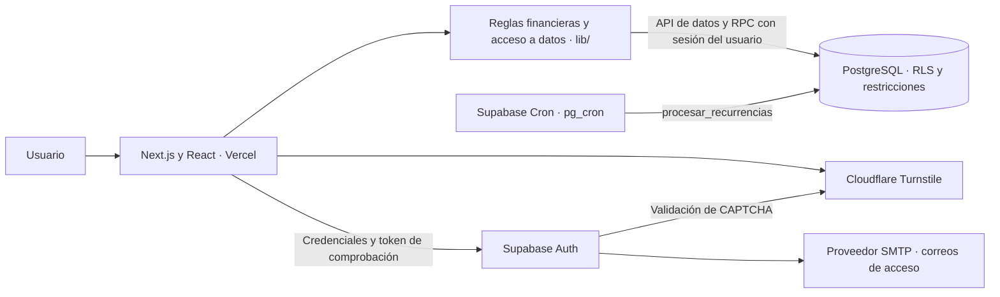

# Flux · Finanzas personales

[](https://github.com/Fede17-9/Gestor_Finanzas/actions/workflows/ci.yml)


Aplicación web para registrar ingresos y gastos, anticipar pagos recurrentes, controlar presupuestos mensuales y reservar dinero para metas de ahorro. Cada usuario administra su propio registro financiero, con una interfaz en español y navegación adaptable a móvil.

**[Probar la beta](https://gestor-finanzas-green.vercel.app/login)** · [Instalación](#instalación-y-ejecución-local) · [Arquitectura](#arquitectura) · [Pruebas](#pruebas-y-validaciones)

## El problema que resuelve

Un pago programado no siempre ocurre en la fecha ni por el importe esperado. Flux distingue entre **movimientos confirmados**, **vencimientos pendientes** y **previsiones**, para que el saldo refleje lo registrado y la planificación conserve lo que todavía falta por pagar o cobrar.

El proyecto concentra registro, planificación y seguimiento en una misma cuenta. Las metas representan reservas de dinero: aportar a una meta conserva su historial sin registrar otro gasto ni descontar nuevamente el saldo general. La aplicación no ejecuta pagos ni se conecta a cuentas bancarias.

## Estado del proyecto

**Beta funcional publicada en Vercel**, con Supabase como servicio de autenticación y base de datos. Los módulos financieros, la recuperación de acceso y la integración de Cloudflare Turnstile están implementados.

El propietario reportó pruebas manuales satisfactorias de registro, confirmación de correo, inicio de sesión y recuperación en el dominio publicado, además del aislamiento entre dos cuentas y del procesamiento programado de recurrencias. Estos resultados son distintos de las pruebas automatizadas: no constituyen una certificación de producción ni una prueba continua de los servicios externos.

La preparación para ampliar el acceso sigue en desarrollo: privacidad y términos, evidencia de autorización de tratamiento, solicitudes sobre datos y respaldos con restauración comprobada están pendientes. Consulta las [limitaciones y próximos pasos](#limitaciones-y-próximos-pasos).

### Cómo evaluar la beta

1. Abre la [aplicación publicada](https://gestor-finanzas-green.vercel.app/login) y crea tu propia cuenta con datos ficticios de perfil y finanzas, y un correo al que tengas acceso.
2. Completa la comprobación de seguridad y confirma el correo; revisa también la carpeta de spam. Abre el enlace en el mismo navegador y perfil donde solicitaste el registro.
3. Registra un ingreso y un gasto. Consulta el saldo, el resumen mensual y el calendario.
4. Crea un presupuesto y una meta; registra un aporte a la meta y revisa su historial.
5. Crea una recurrencia manual con fecha de hoy, pulsa **Actualizar pendientes** y confirma el vencimiento con el importe real. Comprueba que aparece una sola vez en Movimientos.

Cada cuenta empieza con sus propios datos. No se publican credenciales de demostración ni información financiera del autor. La disponibilidad del servicio y de sus correos depende de la configuración y las cuotas de los proveedores.

## Funcionalidades implementadas

- **Cuenta y perfil:** registro con confirmación de correo, inicio y cierre de sesión, recuperación de contraseña, nombre, alias e iconos de perfil. La moneda base se elige al crear el perfil: COP, USD o EUR; posteriormente queda fija.
- **Movimientos:** creación, edición y eliminación de operaciones manuales, categorías, método de pago y búsqueda por descripción, categoría o método. Los movimientos vinculados a vencimientos se gestionan desde Recurrencias.
- **Resumen:** saldo acumulado, ingresos y gastos del mes seleccionado, gráficos por día y categoría, movimientos recientes y avisos de presupuesto.
- **Recurrencias:** reglas diarias, semanales, mensuales y anuales; confirmación manual o automática por regla, pausa, reactivación y archivo. Los vencimientos permiten confirmar el importe y la fecha reales, reprogramar, omitir o deshacer una confirmación conservando su registro en el historial.
- **Calendario:** movimientos confirmados y programación estimada, con navegación mensual y conciliación por identidad del vencimiento para evitar duplicar su representación.
- **Presupuestos:** límites mensuales generales o por categoría, umbral de alerta configurable y seguimiento de egresos confirmados del período. Los límites de categoría no se suman al presupuesto general.
- **Metas de ahorro:** objetivo, fecha y prioridad; saldo inicial, aportes, retiros y reversiones con historial. Archivar conserva el saldo y los registros.
- **Acceso y aislamiento:** políticas de Row Level Security (RLS) por propietario, privilegios de base de datos y comprobaciones en las operaciones transaccionales. Turnstile está integrado en acceso, registro, recuperación y reenvío de confirmación.

## Tecnologías

Versiones resueltas en [package-lock.json](package-lock.json); los rangos de instalación están en [package.json](package.json).

- **Next.js 16.4.2 y React 19.2.3:** App Router para las rutas y React para formularios, estado e interacción. La aplicación financiera consulta Supabase desde componentes cliente.
- **TypeScript 5.9.3:** configuración estricta y contratos de tablas, relaciones y funciones SQL generados desde las migraciones.
- **Supabase JavaScript 2.99.2 y PostgreSQL:** autenticación, persistencia, RLS y funciones transaccionales invocadas mediante RPC.
- **Tailwind CSS 4.2.1 y CSS Modules:** estilos compartidos y estilos específicos de presupuestos; **Lucide React 0.577.0** para iconos y **Recharts 3.8.1** para gráficos.
- **Node.js 24.x, Node Test Runner y PGlite 0.5.10:** ejecución de pruebas TypeScript y PostgreSQL local en memoria, sin credenciales remotas ni Docker.
- **ESLint 9.39.4 y GitHub Actions:** validaciones estáticas, pruebas y compilación en cada push y pull request.
- **Vercel, Supabase Cron y Cloudflare Turnstile:** despliegue de la aplicación, procesamiento periódico y comprobación contra solicitudes automatizadas, respectivamente.

## Arquitectura

Flux utiliza Next.js para la aplicación web y Supabase como backend administrado. No hay una API REST propia implementada en este repositorio: las lecturas y escrituras autorizadas usan la API de datos de Supabase, y las operaciones que requieren atomicidad se ejecutan en PostgreSQL mediante RPC.



### Distribución de responsabilidades

```text
app/                     Rutas, páginas y estilos globales
  auth/callback/         Verificación de enlaces de autenticación
  dashboard/             Resumen y módulos financieros protegidos
components/              Navegación, formularios y elementos compartidos
lib/
  auth.ts                Registro, perfiles, recuperación y enlaces PKCE
  captcha.ts             Token de Turnstile y mensajes de error
  finance.ts             Importes, fechas, resúmenes y proyecciones
  finance-data.ts        Lecturas paginadas y validación de datos recibidos
  planning.ts            Cálculo de presupuestos y progreso de metas
  use-planning.ts        Carga y acciones compartidas de presupuestos/metas
  database.types.ts      Contratos generados desde las migraciones
  supabase.ts            Cliente tipado y configuración de Auth
supabase/                Migraciones y herramientas SQL operativas
scripts/                 Generación y comprobación de tipos del esquema
tests/                   Pruebas de reglas, autenticación e integración SQL
public/                  Iconos de perfil y avisos de licencias
.github/workflows/       Validación continua
```

### Decisiones de integridad

- **Importes:** las reglas de cálculo acumulan centavos enteros y validan el rango admitido; PostgreSQL utiliza `numeric(15,2)`. Las escrituras monetarias pueden enviarse como cadenas decimales para conservar los centavos.
- **Fechas:** las reglas utilizan días civiles y `America/Bogota`; las pruebas cubren cambios de mes y año, días mensuales inexistentes y años bisiestos.
- **Lecturas:** el lector financiero pagina el historial y rechaza respuestas incompletas o con identificadores repetidos. Montar un informe no modifica movimientos.
- **Operaciones atómicas:** confirmar vencimientos y registrar o revertir aportes usa funciones SQL con validación de propietario, restricciones y bloqueos. Los reintentos cubiertos por las pruebas no duplican esos registros.
- **Autorización:** la protección visual de las rutas complementa a RLS y los privilegios en PostgreSQL. La clave pública del navegador no concede permisos administrativos.
- **Tipos reproducibles:** el generador reconstruye las migraciones en PGlite e inspecciona tablas, relaciones y RPC. Comprueba el esquema versionado, no cambios manuales posteriores en Supabase Cloud.

## Instalación y ejecución local

### Requisitos

- Git, **Node.js 24.x** y npm. La versión de Node también se indica en [.nvmrc](.nvmrc).
- Un proyecto de Supabase para desarrollo, con Auth y las migraciones de la aplicación configuradas. Se recomienda separarlo de los datos personales.
- Acceso a Internet para Supabase, correo, Turnstile cuando esté habilitado y la descarga de fuentes Geist durante la compilación.

### Preparar el proyecto

```sh
git clone https://github.com/Fede17-9/Gestor_Finanzas.git
cd Gestor_Finanzas
npm ci
```

La raíz del repositorio contiene `package.json`: no hay que entrar en otra subcarpeta `gestor-finanzas` después de clonarlo.

Crea `.env.local` a partir de [.env.example](.env.example). En PowerShell, sin sobrescribir una configuración existente:

```powershell
if (-not (Test-Path -LiteralPath .env.local)) {
  Copy-Item -LiteralPath .env.example -Destination .env.local
}
```

Configura las variables, prepara la [base de datos](#base-de-datos-y-autenticación) y arranca la aplicación:

```sh
npm run dev
```

Abre [http://localhost:3000](http://localhost:3000). Los formularios operan sobre la base configurada: guardar o eliminar modifica sus datos. Reinicia el servidor de desarrollo después de cambiar las variables.

### Variables de entorno

```dotenv
NEXT_PUBLIC_SUPABASE_URL=
NEXT_PUBLIC_SUPABASE_PUBLISHABLE_KEY=
NEXT_PUBLIC_SUPABASE_ANON_KEY=
NEXT_PUBLIC_TURNSTILE_SITE_KEY=
```

- **`NEXT_PUBLIC_SUPABASE_URL`:** URL del proyecto Supabase utilizado por esta instalación.
- **`NEXT_PUBLIC_SUPABASE_PUBLISHABLE_KEY`:** clave pública recomendada para nuevas configuraciones.
- **`NEXT_PUBLIC_SUPABASE_ANON_KEY`:** alternativa compatible con la clave pública heredada. Basta con configurar una de las dos claves; si ambas existen, el cliente prioriza `PUBLISHABLE_KEY`.
- **`NEXT_PUBLIC_TURNSTILE_SITE_KEY`:** clave pública del widget. Es opcional mientras CAPTCHA esté desactivado en Supabase; si el servidor exige CAPTCHA, el cliente necesita una clave válida para ese hostname.

Las variables `NEXT_PUBLIC_*` llegan al navegador. **Nunca deben contener claves secretas, `service_role`, contraseñas SMTP ni credenciales administrativas.** La Secret Key de Turnstile y las credenciales SMTP se configuran exclusivamente en Supabase. Los archivos `.env.local`, `.vercel` y los respaldos de `supabase/backups/` están excluidos de Git.

## Base de datos y autenticación

En un **proyecto nuevo sin tablas de Flux**, ejecuta en el SQL Editor de Supabase estas migraciones, en orden:

1. [Baseline](supabase/migrations/20261020000100_baseline.sql): tablas iniciales y catálogo de tipos de movimiento.
2. [Validación y aislamiento](supabase/migrations/20261020000200_private_finance.sql): restricciones, índices, privilegios y RLS.
3. [Vencimientos recurrentes](supabase/migrations/20261022000100_recurrence_occurrences.sql): reglas, ocurrencias, historial y procesamiento.
4. [Presupuestos y registro de ahorro](supabase/migrations/20261022000200_budgets_and_goal_ledger.sql): operaciones de planificación, aportes y reversiones.

En una base existente, revisa su esquema y las migraciones ya aplicadas antes de cambiarlo. **No repitas la baseline ni ejecutes un reset sobre información que debas conservar.** Aplicar SQL manualmente no reconcilia por sí solo el historial de Supabase CLI.

La configuración externa de autenticación requiere:

- Activar la confirmación de correo y configurar un proveedor SMTP para registro, confirmación y recuperación.
- Establecer **Site URL** para la instalación y autorizar las redirecciones de sus enlaces.
- Para desarrollo local, permitir `http://localhost:3000/auth/callback**`.
- Para la beta publicada, los callbacks utilizados son:
  - `https://gestor-finanzas-green.vercel.app/auth/callback?next=%2Fdashboard`
  - `https://gestor-finanzas-green.vercel.app/auth/callback?next=%2Factualizar-clave`

Para otra instalación, sustituye el origen por su dominio. Auth utiliza PKCE; los enlaces nuevos deben abrirse en el navegador y perfil desde el que se solicitaron. La persistencia de sesión usa el almacenamiento del navegador; el flujo de recuperación también utiliza `sessionStorage` temporal.

Para procesar recurrencias con la aplicación cerrada, habilita Supabase Cron (`pg_cron`) y ejecuta [enable_recurrence_cron.sql](supabase/enable_recurrence_cron.sql). La tarea `flux-recurrencias` invoca el procesamiento cada quince minutos. Las reglas manuales conservan sus vencimientos pendientes; solo las configuradas como automáticas generan su movimiento confirmado mediante el procesador. Este registro automático no ejecuta una transferencia bancaria.

La [documentación de base de datos](supabase/README.md) detalla las migraciones, la [inspección de estructura y permisos](supabase/inspect.sql) y la [verificación administrativa de aislamiento](supabase/verify_isolation.sql). Revisa sus requisitos antes de usar estas herramientas en un proyecto remoto.

### Configurar Turnstile

1. Crea un widget **Managed** con los hostnames de producción y `localhost`, sin protocolo, puerto ni ruta. Deja *pre-clearance* desactivado.
2. Configura su **Site Key pública** como `NEXT_PUBLIC_TURNSTILE_SITE_KEY` en Vercel Production y en el `.env.local` de desarrollo. En Vercel puede utilizar el tipo **Config**.
3. Despliega o reinicia y comprueba que el widget carga y completa la verificación.
4. Después activa CAPTCHA en Supabase Authentication → Attack Protection, elige Turnstile y guarda allí la **Secret Key**. El cambio afecta a todos los clientes que utilicen ese proyecto, incluido localhost.
5. Prueba registro, reenvío, acceso incorrecto seguido de correcto y recuperación. Comprueba también que el servidor rechace una solicitud sin token.

El cliente renueva la comprobación tras cada intento y no persiste sus tokens. El widget necesita validación del servidor para proteger las solicitudes. Si una configuración fallida impide acceder, revisa hostnames y claves; desactivar temporalmente CAPTCHA en Supabase permite corregirla sin desactivar RLS ni la confirmación de correo.

## Pruebas y validaciones

La suite utiliza **Node Test Runner** y **PGlite**, una implementación de PostgreSQL que permite probar SQL en memoria. Las pruebas preparan roles y usuarios ficticios; no se conectan a la base remota ni envían correos reales.

La revisión del **4 de noviembre de 2026** ejecutó **97 pruebas**, todas satisfactorias:

- [Autenticación — 26](tests/auth.test.mjs): perfiles, confirmación, recuperación, PKCE, redirecciones y conservación del icono elegido.
- [CAPTCHA — 5](tests/captcha.test.mjs): tokens, errores y transmisión HTTP con el SDK real de Supabase y un transporte ficticio.
- [Base de datos — 16](tests/database.test.mjs): permisos, RLS, aislamiento A/B, restricciones y reversión de migraciones inválidas.
- [Reglas financieras — 24](tests/finance.test.mjs): centavos, fechas, resúmenes, proyecciones y lectura paginada sin modificar el historial.
- [Presupuestos y metas — 11](tests/planning.test.mjs): umbrales, aportes, retiros, reversiones, idempotencia y aislamiento.
- [Recurrencias — 15](tests/recurrences.test.mjs): confirmaciones concurrentes, reintentos, estados, procesamiento automático y conciliación con el calendario.

Además, [database.contract.ts](tests/types/database.contract.ts) comprueba durante el análisis de TypeScript que se rechacen tablas, columnas y argumentos RPC incorrectos.

```sh
npm test
npm run db:types:check
npm run typecheck
npm run lint
npm audit --omit=dev --audit-level=high
npm run build
```

Para regenerar los tipos después de modificar las migraciones, ejecuta `npm run db:types` y revisa el cambio en `lib/database.types.ts`.

[GitHub Actions](.github/workflows/ci.yml) ejecuta instalación con lockfile, comprobación de tipos del esquema, pruebas, TypeScript, ESLint, auditoría de dependencias de producción y build en cada push y pull request. Utiliza variables ficticias, sin acceso a los datos personales.

La suite no mide cobertura porcentual ni incluye pruebas de navegador de extremo a extremo. Tampoco certifica la entrega de correo, la activación remota de CAPTCHA, la ejecución real de Cron ni la equivalencia de un esquema remoto modificado manualmente.

## Despliegue

La beta se aloja en **Vercel Hobby** y mantiene autenticación y datos en Supabase. Para otra instalación:

1. Importa el repositorio en Vercel como aplicación Next.js, con **Root Directory: `./`** y `main` como rama de producción.
2. Configura las variables de Supabase y, cuando corresponda, la Site Key de Turnstile en **Production**. Cambiar variables públicas requiere un nuevo despliegue.
3. Configura en Supabase las URLs de Auth, SMTP, protección contra abuso y la tarea de recurrencias descritas arriba.
4. Despliega y comprueba los flujos de cuenta y finanzas en el dominio definitivo.

[vercel.json](vercel.json) habilita despliegues automáticos solo para `main`; las ramas se validan en GitHub Actions. Las previews que necesiten datos requieren un entorno de pruebas separado y su habilitación explícita.

Para ejecutar localmente una compilación de producción:

```sh
npm run build
npm start
```

Las migraciones, la configuración de Auth y los respaldos se administran por separado. Publicar el repositorio o fusionar una rama no aplica cambios a Supabase ni respalda los movimientos.

## Limitaciones y próximos pasos

- **Publicación responsable:** completar privacidad, términos, autorización de tratamiento y procedimiento de solicitudes sobre datos antes de ampliar la beta.
- **Gestión de cuenta:** descarga de datos y cierre de cuenta desde la aplicación todavía no implementados.
- **Respaldo:** preparar copias privadas de la base y comprobar su restauración en un entorno separado. GitHub conserva código y migraciones, no los movimientos de los usuarios.
- **Correo y abuso:** seguir comprobando entrega y spam, límites del proveedor y rechazo de peticiones sin token. La entrega mediante SMTP ya fue probada por el propietario; su configuración no está contenida en las migraciones.
- **Validación visual:** ampliar las pruebas desde teléfonos reales e incorporar pruebas automatizadas de navegador. El repositorio no incluye capturas de producto versionadas.
- **Alcance financiero:** cada cuenta utiliza una sola moneda, sin conversión de divisas, conexión bancaria ni finanzas compartidas entre usuarios. El calendario proyecta datos de las reglas, no movimientos bancarios futuros garantizados.

## Autor y recursos

**Juan Federico Pulido Betancur** — estudiante de Ingeniería de Sistemas y Computación y Tecnólogo en Análisis y Desarrollo de Software.

[GitHub · Fede17-9](https://github.com/Fede17-9) · [Contacto](mailto:jufepube@gmail.com)

Los recursos de terceros y sus licencias se detallan en [Créditos](app/creditos/page.tsx) y en los [avisos de licencias](public/third-party-notices.txt). El repositorio todavía no define una licencia para el código propio; las licencias de sus dependencias no conceden por sí solas permiso de reutilización de toda la aplicación.
